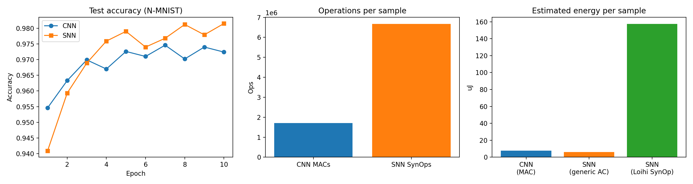

# Event-Driven SNN vs CNN Baseline on N-MNIST

Baseline experiment for my master's thesis on hardware-efficient spiking neural networks (SNNs) for event-based vision. It compares a frame-based CNN with a convolutional SNN of the same layout, and estimates operations and energy per inference.

## Results (single run, seed 42, 10 epochs)

| | CNN | SNN |
|---|---|---|
| Test accuracy | 97.24% | 98.15% |
| Operations per sample | 1.71 M MACs | 6.68 M SynOps |
| Energy, generic arithmetic | 7.86 µJ | 6.01 µJ |
| Energy, Loihi synaptic cost | n/a | 157.57 µJ |

Average firing rate per layer (spikes per neuron per time step): input 4.4%, layer 1 10.8%, layer 2 34.8%, output 11.0%.

## Setup

- Dataset: N-MNIST, loaded with [Tonic](https://github.com/neuromorphs/tonic). The SNN uses 25 time bins, and the CNN uses all events summed into one frame.
- Models: Conv(2→12, 5x5) → pool → Conv(12→32, 5x5) → pool → FC(800→10). The CNN uses ReLU, and the SNN uses LIF neurons (beta 0.9) trained with a surrogate gradient via [snnTorch](https://github.com/jeshraghian/snntorch).
- Training: Adam, learning rate 2e-3, batch size 128, 10 epochs.

## How to run

1. Open `notebook.ipynb` in Google Colab and set the runtime to a T4 GPU.
2. Set `QUICK = False` in the config cell and run all cells.
3. Expect roughly 40 minutes on a T4 for 10 epochs.

## Energy estimation assumptions

Energy figures are analytical estimates, not hardware measurements.
- CNN energy is MACs times 4.6 pJ, and generic SNN energy is SynOps times 0.9 pJ (Horowitz, ISSCC 2014, 45 nm).
- Loihi SNN energy is SynOps times 23.6 pJ, the minimum synaptic spike operation energy from Davies et al., 2018 (pre-silicon, 14 nm).
- The two cost models come from different process nodes and are not directly comparable.
- Neuron state updates and memory access are not counted. Fan-out ignores border effects.

## Limitations

Single seed with no error bars. The CNN baseline sees a single collapsed frame, so it has less temporal information than the SNN. N-MNIST is a small benchmark.

## Next steps

Multiple seeds, a CNN baseline with stacked time bins, sparsity regularization and time-step sweeps, a better energy model, and a harder benchmark such as DVS128 Gesture.

## References

- Roy, Jaiswal, Panda, "Towards spike-based machine intelligence with neuromorphic computing," Nature, 2019.
- Davies et al., "Loihi: A neuromorphic manycore processor with on-chip learning," IEEE Micro, 2018.
- Orchard et al., "Converting static image datasets to spiking neuromorphic datasets using saccades," Frontiers in Neuroscience, 2015.
- Eshraghian et al., "Training spiking neural networks using lessons from deep learning," Proc. IEEE, 2023.
